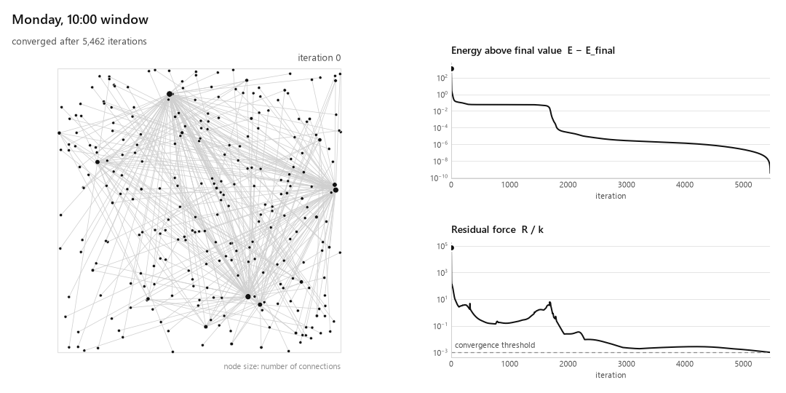

# Fruchterman-Reingold Network Behavior Anomaly Detection Simulation

A network behavior anomaly detection system that models traffic as a graph, applies a Fruchterman-Reingold force-directed simulation, and identifies attacks by monitoring the physical observables of the simulation.

## Project Overview

This project investigates whether force-directed graph algorithms can serve as the basis for a network behavior intrusion detection system.

#### Main Idea:
Network traffic between hosts define a graph, IP addresses are nodes and communications are edges. When this graph is laid out using a Fruchterman-Reingold model, nodes that communicate frequently are pulled together by attractive spring forces, while all nodes repel each other to prevent overlap. The system reaches an equilibrium where the layout reflects the communication structure of the network.

#### How does it differentiate benign behavior from attacks?

When an attack happens, the graph structure changes abruptly. When a port scan happens, it creates a burst of new edges from a single source to many targets. When a DDoS attack happens, it funnels edges from many sources toward one victim. These structural changes disrupt the simulation's equilibrium, producing spikes in total system energy, node displacements, and delayed convergence. By tracking these simulation observables over time and comparing them to benign behavior, the system flags anomalous time windows.

This approach is a form of novelty detection, which consists of using a reference of normal behavior (assumed clean data) from traffic assumed to be benign, so that time windows that deviate from that (unknown data) are flagged. The method does not require labelled attack examples, but it does depend on a clean reference period. Labels are used only to evaluate the detector.

### Dataset

This project uses the CICIDS2017 dataset from the Canadian Institute for Cybersecurity at the University of New Brunswick. It has labeled network flows over five days, covering benign traffic and multiple attack types.

Source: https://www.unb.ca/cic/datasets/ids-2017.html

The project uses the flow files from `GeneratedLabelledFlows.zip`, because they are the only CSV release that keeps the Source IP, Destination IP and Timestamp columns needed to build a graph per time window.

## Model

According to Fruchterman and Reingold, two forces act on the nodes. For two nodes separated by a distance $d$, every pair repels with a force of magnitude

$$
f_r(d) = \frac{k^2}{d},
$$

and every pair of nodes joined by an edge attracts with a force of magnitude

$$
f_a(d) = \frac{d^2}{k}.
$$

Repulsion is strong when nodes are close and fade with distance, which keeps nodes from overlapping. Attraction behaves like a spring that grows stronger as connected nodes move apart, which keeps communicating hosts together. The constant $k$ is the ideal distance between nodes, computed from the area of the drawing frame.

A third force, adapted from the "strong gravity" of ForceAtlas2 *(Jacomy et al., 2014)*, pulls every node toward the center of the frame with a strength proportional to its distance $r$ from the center:

$$
f_g(r) = g \, r
$$

Without this force, groups of hosts that don't communicate with the rest of the network would repel each other indefinitely and it would prevent the simulation from reaching equilibrium.

#### How iterations work

At each iteration every node moves a small step in the direction of its net force, with the step scaled to how strongly connected the node is so that busy hosts do not overshoot. The simulation converges when the largest remaining force on any node falls below a small fraction of $k$.

## Example: one minute of benign traffic



The animation shows the simulation of the traffic captured between 10:00 and 10:01 on Monday, the benign baseline day of CICIDS2017. Each of the 277 nodes is a host, and node size grows with its number of connections. The layout settles into a few large hubs, internal hosts of the lab network, each surrounded by the external addresses that communicated only with it. The panels on the right track the energy above its final value and the largest remaining force on any node.

## Project Structure

```
force-directed-NBAD/
├── data/raw/                  # CICIDS2017 CSV files (untracked)
├── docs/figures/              # Figures shown in this README
├── src/
│   ├── graph_builder.py       # CSV loading and graph construction per time window
│   ├── force_simulation.py    # Force model, energy and position updates
│   ├── example_graphs.py      # Small hand-built graphs with known layouts
│   ├── visualizer.py          # Convergence plots and animation of the simulation
│   ├── theme.py               # Shared visual style for figures
│   ├── metrics.py             # Energy, displacement, convergence extraction (planned)
│   └── detector.py            # Anomaly flagging (planned)
├── notebooks/                 # Exploration and evaluation notebooks (planned)
├── tests/
│   ├── test_graph_builder.py  # Graph construction on a hand-made set of flows
│   ├── test_forces.py         # Force formulas and the energy gradient
│   └── test_convergence.py    # Two-node equilibrium and convergence on simple graphs
├── results/                   # Output plots and animations (untracked)
├── pytest.ini
├── requirements.txt
├── LICENSE
└── README.md
```

## Installation

Clone the repository and set up a Python virtual environment:

```bash
git clone https://github.com/adlune/force-directed-NBAD.git
cd force-directed-NBAD
python -m venv .NBAD
source .NBAD/bin/activate        # macOS and Linux
source .NBAD/Scripts/activate    # Windows (Git Bash)
.NBAD\Scripts\Activate.ps1       # Windows (PowerShell)
pip install -r requirements.txt
```

The CICIDS2017 dataset must be downloaded separately. Download `GeneratedLabelledFlows.zip` from the dataset page and place the CSV files from its `TrafficLabelling` folder into the `data/raw/` directory.

## Usage

Run the test suite:

```bash
python -m pytest
```

Generate the convergence figures and animations for a small example graph and for one window of benign traffic (Monday, 10:00). The output is written to `results/`:

```bash
python src/visualizer.py
```

Detection on attack traffic is not implemented yet.

## License

This project is licensed under the MIT License. See the [LICENSE](LICENSE) file for the full text.

## Contact Information

- **Author:** Adrian Lara *[Undergraduate student in Information Technologies for Sciences at the National Autonomous University of Mexico (UNAM)]*.
- **Contact:** contact@adrianlara.dev

## Acknowledgements

This project was developed as part of a Modeling and Simulation course.

Development was assisted by Claude Code Opus 5.5 (Anthropic). All code and documentation were reviewed by the author. AI assistance was used as a collaborative tool to support the learning and development process.

### Key References

The theoretical foundation for this project draws from the following works.

1. Eades, P. (1984). "A heuristic for graph drawing." *Congressus Numerantium*, 42, 149-160.
2. Fruchterman, T. and Reingold, E. (1991). "Graph drawing by force-directed placement." *Software: Practice and Experience*, 21(11), 1129-1164.
3. Barnes, J. and Hut, P. (1986). "A hierarchical O(N log N) force-calculation algorithm." *Nature*, 324, 446-449.
4. Jacomy, M., Venturini, T., Heymann, S. and Bastian, M. (2014). "ForceAtlas2, a Continuous Graph Layout Algorithm for Handy Network Visualization Designed for the Gephi Software." *PLoS ONE*, 9(6), e98679.
5. Tolle, J. and Niggemann, O. (2000). "Supporting intrusion detection by graph clustering and graph drawing." *Proc. 3rd International Workshop on Recent Advances in Intrusion Detection (RAID 2000)*, LNCS 1907.
