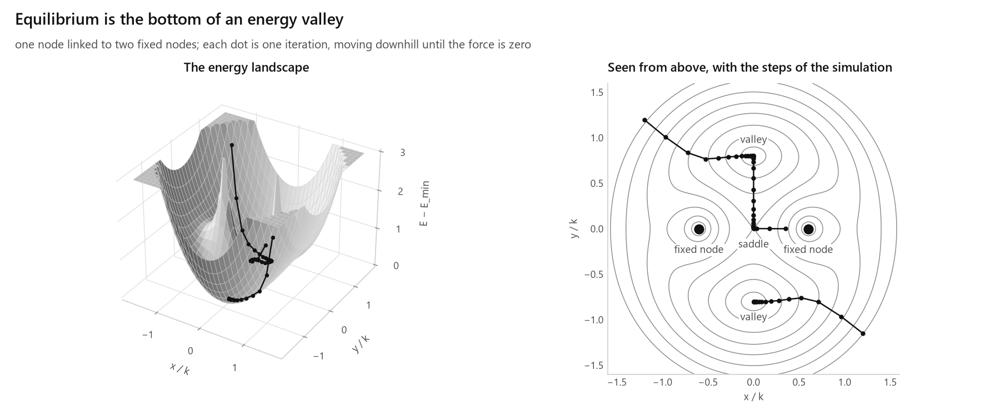
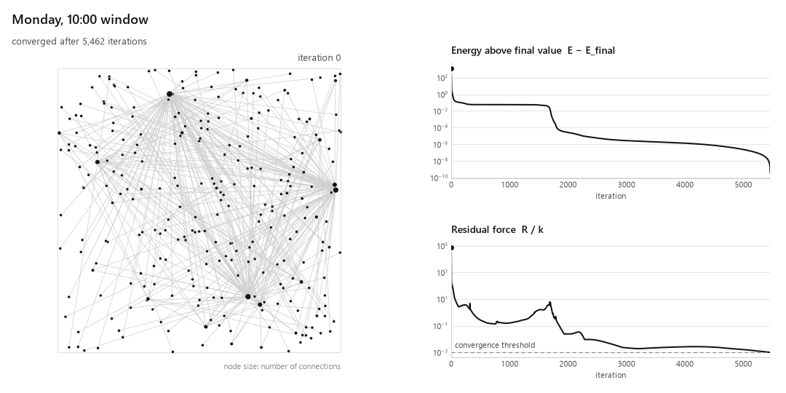

# force-directed NBAD

Network behavior anomaly detection model using force based graph simulation.

## Main idea

Raw data is processed so each graph visualization is a time window (1 minute each). The model treats IP addresses as nodes, and two hosts that exchanged at least one flow are joined by an edge. This is laid out with the Fruchterman-Reingold model and relaxed until its forces balance and it reaches convergence.

## Model

```math
\begin{aligned}
F_{\text{repulsion}} &= \frac{k^2}{d} && \text{acts between every pair of nodes} \\[4pt]
F_{\text{attraction}} &= \frac{d^2}{k} && \text{acts between connected nodes} \\[4pt]
F_{\text{gravity}} &= g\,r && \text{acts between each node and the center}
\end{aligned}
```

Where $d$ is the distance between two nodes, $r$ is the distance to the center, and $k$ is the ideal distance between nodes. The *gravity* term, borrowed from ForceAtlas2, keeps hosts that do not communicate with the rest of the network from drifting apart and affecting convergence.

### Equilibrium as an energy valley

There is no mass or velocity in the simulation. At every iteration each node simply takes a step in the direction of its force. Each force is minus the slope of an energy, so every step goes downhill, and the simulation is a form of gradient descent on the energy of the layout. Equilibrium, where every force is zero, is the bottom of a valley. Each node's step is scaled to how sharply the energy curves around it, which keeps the descent stable for busy hubs and single-link leaves alike.



The example has two valleys with a saddle point between them. The energy of a real window has many valleys, so different starting layouts can settle in slightly different equilibria.

(not yet implemented) Attacks will change the shape and overall behavior of the traffic. The hypothesis is that these changes show up in the physics: a different energy at equilibrium, nodes that show unusual movement, and more iterations to settle. Measuring these numbers on a benign baseline and flagging numbers that deviate from it makes this a form of novelty detection.

## Example



One minute of benign traffic (Monday, 10:00) with 277 hosts settling into equilibrium.


## Usage

```bash
git clone https://github.com/adlune/force-directed-NBAD.git
cd force-directed-NBAD
python -m venv .NBAD
.NBAD\Scripts\activate          # macOS or Linux: source .NBAD/bin/activate
pip install -r requirements.txt
```

The data comes from [CICIDS2017](https://www.unb.ca/cic/datasets/ids-2017.html). Download **GeneratedLabelledFlows.zip** and copy the CSV files from its **TrafficLabelling** folder into **data/raw/**. These CSV files keep the IPs and the timestamps so it's necessary for running the model.

```bash
python -m pytest                # tests
python src/visualizer.py        # example figures and animations in results/
python src/energy_valley.py     # the energy valley figure above
python src/run_windows.py data/raw/Monday-WorkingHours.pcap_ISCX.csv --start 10:00 --end 11:00
```

The last command simulates every minute between 10:00 and 11:00 and writes one row of measurements per minute to **results/windows.csv**.

## Current status

The simulation can run over consecutive minutes in parallel. Next step is running full days and comparing the benign Monday behavior against Friday's attacks.

## About

Made by Adrian Lara (contact@adrianlara.dev). 

This project was developed as a part of a Modeling and Simulation course, under the [MIT License](LICENSE).

Development was assisted by Claude Code (Opus 5.5, Anthropic) as a collaborative learning tool; all code and documentation were reviewed by the author.

### References

1. Fruchterman, T. and Reingold, E. (1991). "Graph drawing by force-directed placement." *Software: Practice and Experience*, 21(11), 1129-1164.
2. Jacomy, M., Venturini, T., Heymann, S. and Bastian, M. (2014). "ForceAtlas2, a Continuous Graph Layout Algorithm for Handy Network Visualization Designed for the Gephi Software." *PLoS ONE*, 9(6), e98679.
3. Tolle, J. and Niggemann, O. (2000). "Supporting intrusion detection by graph clustering and graph drawing." *Proc. RAID 2000*, LNCS 1907.
